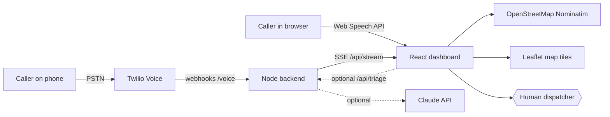

<div align="center">

# SahayAI India

**Every 112 call answered. The most critical, first.**

An AI copilot for India's emergency response. It listens to callers in Hindi, Marathi and English, ranks every incident by urgency, and puts a clear brief on a human dispatcher's screen while the caller is still talking.


</div>

---

## The problem

When a city has a flood, a fire and a road accident in the same ten minutes, emergency lines queue up and callers wait. Dispatchers must work out who needs help first, in several languages, while taking notes by hand. Seconds lost at triage are seconds lost for the patient.

## What DispatchAI does

| Capability | How it works |
|---|---|
| **Multilingual voice calls** | The caller speaks Hindi, Marathi or English. The AI replies by voice in the same language and asks the three questions that matter: what happened, where, and how many people are hurt. |
| **Instant triage** | Classifies the call (fire, medical, road accident, crime, women's safety, flood or disaster) and scores priority from **P1 Critical** to **P4 Low**. |
| **Distress detection** | Panic words, exclamations and speech rate raise the score, so a terrified caller is not buried under a calm one. |
| **Location understanding** | Recognises Indian landmarks and cities in English, Hindi and Marathi, geocodes new places with OpenStreetMap, and accepts the caller's GPS. |
| **Right unit, right number** | Recommends the correct service: 108 ambulance, 101 fire, 100 police, 1091 women's helpline, 1078 disaster response. |
| **Live map** | Every active incident appears as a priority-coloured pin. |
| **Real phone line** | Optional Twilio integration: callers dial a real number and appear in the queue within seconds, with a one-tap call-back. |
| **Smarter triage with Claude** | Optional: add an API key and each caller sentence is analysed by Claude for category, life-threat count, headcount and a one-line brief. |
| **Human in charge** | The AI only drafts. The dispatcher confirms, edits the category or priority, dispatches, or rejects a false alarm. |


## Quick start

You need Node.js 20.12 or newer and Chrome (for speech recognition).

```bash
git clone https://github.com/YOUR-USERNAME/dispatchai-india.git
cd dispatchai-india
npm install
npm run dev
```

Open **http://localhost:5173** and click **Run a live demo**. Triage, map, location search and voice all work with no API keys.

To try a live call: choose a language, click **Start call**, allow the microphone and say, for example, *"ठाणे स्टेशन के पास आग लगी है"*. If your microphone is unavailable, type in the box instead.

## Architecture



- **Dashboard** (`src/`): React 18 + Vite. Handles the browser call simulator, queue, incident detail and map.
- **Backend** (`server/`): a dependency-free Node server. It answers Twilio voice webhooks with TwiML, streams incidents to the dashboard over Server-Sent Events, and optionally calls Claude.
- **Shared triage engine** (`src/triage.js`): the same code scores calls in the browser and on the phone line.

## How triage scores a call

```
score = category base            (fire 65, medical 60, disaster 60, women 60, accident 55, crime 50, other 20)
      + 14 per life-threat sign  (unconscious, trapped, bleeding, weapon, child, smoke... max 3)
      + 8 if three or more people are affected
      + 20% of caller distress   (panic words, "!", fast speech)

P1 Critical  >= 72      P2 High  >= 58      P3 Medium  >= 40      P4 Low  < 40
```

Keywords cover English, Hindi (Devanagari and Hinglish) and Marathi. When Claude is enabled its output is merged into the same score, so the dispatcher always sees one consistent ranking.

## Configuration

Copy `.env.example` to `.env`. Every variable is optional.

| Variable | Used by | Purpose |
|---|---|---|
| `VITE_MAPTILER_KEY` | dashboard | Better map tiles (free key from maptiler.com). Without it, OpenStreetMap tiles are used. |
| `ANTHROPIC_API_KEY` | backend only | Enables Claude-assisted triage. The key never reaches the browser. |
| `ANTHROPIC_MODEL` | backend | Model name. Defaults to `claude-sonnet-5-5`. |
| `PORT` | backend | Backend port. Defaults to `8787`. |

## Take real phone calls with Twilio

1. Create a Twilio account and get a voice number (a trial number works).
2. Start the backend in a second terminal: `npm run server`
3. Expose it: `ngrok http 8787` and copy the https URL.
4. In **Twilio Console → Phone Numbers → your number → Voice**, set *A call comes in* to **Webhook**, method **POST**, URL `https://YOUR-NGROK-URL/voice`.
5. Call the number. Press **1** for English or **2** for Hindi, then describe an emergency. The incident appears in the queue with its priority, location and a **Call back** button.

Trial accounts can only be called from verified numbers. The phone line currently offers English and Hindi. Marathi is available in the browser.

## Backend API

| Method | Route | Description |
|---|---|---|
| `GET` | `/api/health` | `{ ok, llm }`. Tells the dashboard whether the backend and Claude are available. |
| `GET` | `/api/stream` | Server-Sent Events feed of incidents as they change. |
| `POST` | `/api/triage` | `{ text }` returns structured triage from Claude (501 if no key is set). |
| `POST` | `/api/incident` | `{ id, status, ov }` syncs a dispatcher's edits for phone incidents. |
| `POST` | `/voice` | Twilio entry webhook: language menu. |
| `POST` | `/voice/lang` | Starts the incident and the first question. |
| `POST` | `/voice/turn` | Handles each spoken answer and replies with the next question. |

## Project structure

```
dispatchai-india/
├─ index.html            # loads fonts and Leaflet
├─ vite.config.js        # dev proxy to the backend
├─ src/
│  ├─ App.jsx            # hero, caller simulator, queue, detail, how-it-works
│  ├─ MapView.jsx        # Leaflet map with priority pins
│  ├─ triage.js          # categories, scoring, languages, dialogue (shared with backend)
│  ├─ geo.js             # Nominatim geocoding and reverse geocoding
│  ├─ main.jsx
│  └─ styles.css
├─ server/index.js       # Twilio webhooks, SSE feed, optional Claude triage
├─ docs/                 # README images
└─ .env.example
```

## Deploy

```bash
npm run build
npm start
```

`npm start` runs the backend, which also serves the built site, so one service (Render, Railway, Fly.io and similar) hosts the dashboard and the phone webhooks at a single URL. Remember to set the Twilio webhook to that URL.

## Limitations

- Triage is keyword-and-score based unless Claude is enabled. It can miss unusual phrasing, so a human always reviews it.
- Browser speech recognition works best in Chrome and Edge. Marathi and Hindi voice quality depends on the voices installed on the device.
- Location search covers Latin-script place names through OpenStreetMap, plus a built-in list of major Indian cities and landmarks in three scripts.
- The phone line stores incidents in memory only. Restarting the backend clears them.

## Roadmap

- [ ] More languages: Tamil, Telugu, Bengali, Gujarati, Kannada
- [ ] Marathi on the phone line
- [ ] Persistent storage and dispatcher login
- [ ] Twilio request-signature validation
- [ ] Nearest-unit suggestions using live unit locations
- [ ] Translation of non-English transcripts for dispatchers

## Safety and disclaimer

This is a demonstration project. It is **not connected to India's real 112 service** and must never be used for real emergencies. For any production use you would need request validation, dispatcher authentication, encrypted storage, call-recording consent, and a formal safety review.

## License

[MIT](LICENSE)
